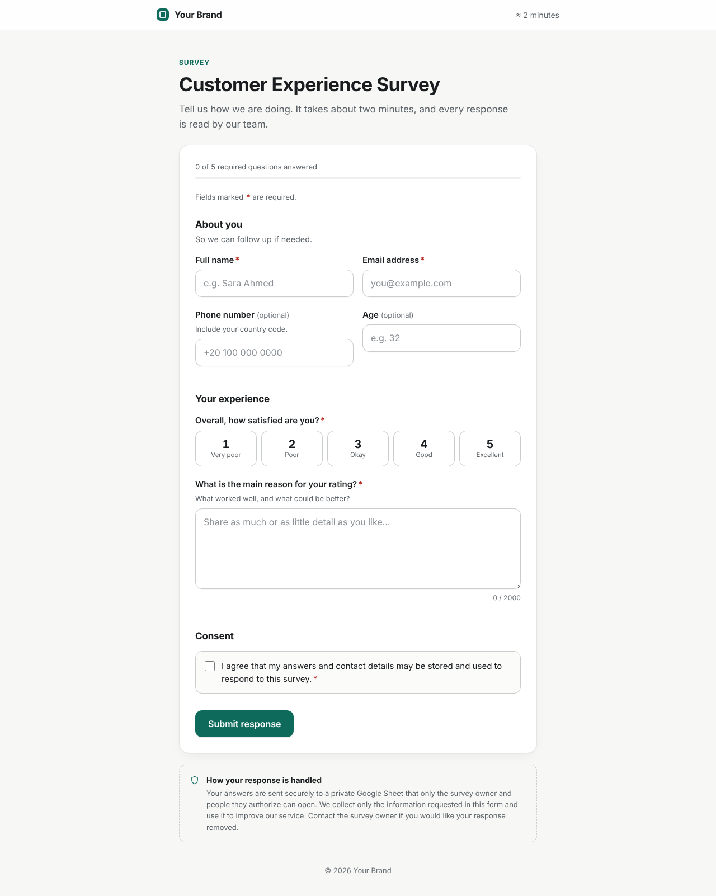
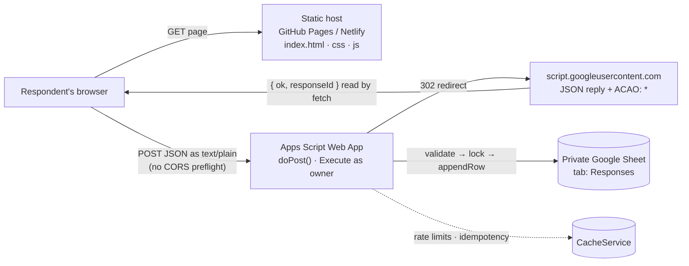

# Survey App — static website + Google Apps Script + Google Sheets

A professional, responsive public survey. Visitors fill it in without signing in; each response is validated in the browser, validated again on the server, and appended as one row to a private Google Sheet. The page shows "Thank you" **only after the server confirms the row was written**.



## Features

- Clean, accessible form rendered from a single config file — change wording, branding and questions without touching the app logic
- Question types: text, email, phone, number, long text, single choice (select or radio), multiple choice (checkboxes), 1–N rating, consent
- Inline validation, an error summary with jump links, progress indicator and character counter
- Loading state, duplicate-click protection, 20 s timeout, retry that **never creates duplicate rows**
- Answers are kept on any error; "Submit another response" after success; reference ID shown to the respondent
- Backend: server-side validation, length limits, unknown-field stripping, formula-injection protection, script lock for concurrent writes, honeypot, minimum fill time, rate limits
- Non-destructive spreadsheet setup that preserves existing data and maps columns by header name
- WCAG-minded: semantic HTML, labels, keyboard support, visible focus, AA contrast, reduced-motion support
- No frameworks, no build step, no paid services. 58 automated tests (unit, backend, real-browser)

## Architecture



1. The browser validates the answers and sends them with a random `submissionId`.
2. Apps Script re-validates everything, takes a lock, appends a row with a server timestamp and Response ID, and caches the result under the `submissionId`.
3. Apps Script's reply comes back through Google's standard redirect; the page reads the JSON and shows success only for `ok: true`. Why this request style is used, and the alternatives, are explained in [SECURITY.md → Cross-origin requests](docs/SECURITY.md#cross-origin-requests-how-the-browser-gets-a-readable-answer).

## Technology

HTML5, CSS3, vanilla JavaScript (ES5-compatible syntax, no dependencies) · Google Apps Script (V8) · Google Sheets · GitHub Pages or Netlify · Node.js only for tests and the local dev server.

## Folder structure

```
survey-app/
├── index.html                  Page shell, CSP, honeypot, success/error regions
├── css/styles.css              Design tokens (edit :root) and responsive styles
├── js/
│   ├── form-config.js          ← EDIT: branding, copy, questions, endpoint URL
│   ├── validation.js           Client validation (also used by Node tests)
│   └── app.js                  Rendering, events, submission, states
├── apps-script/
│   ├── Code.gs                 ← PASTE into Apps Script: backend + setupSheet()
│   └── appsscript.json         ← PASTE: manifest (V8, minimal scope, web app)
├── docs/
│   ├── SETUP.md                Sheet + Apps Script, step by step
│   ├── DEPLOYMENT.md           Publish the website, verify, troubleshoot
│   ├── TESTING.md              How to test + actual results + manual checklist
│   ├── SECURITY.md             Protections, limitations, privacy
│   └── screenshots/
├── tests/
│   ├── unit/                   validation, backend (real Code.gs in a VM), config sync
│   ├── e2e/                    Playwright browser tests
│   └── helpers/gas-harness.js  Apps Script service mocks
├── tools/dev-server.js         Local site + mock Apps Script (no Google needed)
├── .github/workflows/deploy-pages.yml   Test + publish site files to GitHub Pages
├── package.json
└── .gitignore
```

## Quick start

### Try it locally (no Google account)

```bash
npm run start:mock
# open http://localhost:5173 — responses go to an in-memory sheet:
# http://localhost:5174/__dev/rows  (nothing reaches Google)
```

`npm start` uses your **real** Apps Script URL once `endpoint` is set in `js/form-config.js` (and says so in the console); with an empty endpoint it falls back to the mock.

Requires Node.js 18+. Opening `index.html` directly from disk also renders the form, but submitting needs a configured endpoint.

### Go live

1. **Google Sheet + Apps Script** — follow [docs/SETUP.md](docs/SETUP.md): create the sheet, paste `Code.gs` and `appsscript.json`, run `setupSheet`, deploy as Web App (*Execute as: Me*, *Who has access: Anyone*), copy the `/exec` URL.
2. **Configure** — paste the URL into `endpoint` in `js/form-config.js`, and set `brandName`, `title`, `description` and `privacyNotice`.
3. **Publish** — follow [docs/DEPLOYMENT.md](docs/DEPLOYMENT.md) (GitHub Pages or Netlify).
4. **Verify** — work through the manual checklist in [docs/TESTING.md](docs/TESTING.md#manual-integration-checklist-needs-your-google-account).

## Configuration

Everything visible is in `js/form-config.js`:

```js
brandName: 'Your Brand',
title: 'Customer Experience Survey',
description: '…',
endpoint: 'https://script.google.com/macros/s/AKfycb…/exec',
successTitle: '…', successMessage: '…', privacyNotice: '…',
sections: [ { title: 'About you', fields: [ { id: 'name', type: 'text', label: 'Full name', required: true, … } ] } ]
```

Colours, radius and fonts are CSS variables at the top of `css/styles.css` (`--accent` is the single brand colour).

Backend settings (sheet name, timezone, rate limits) are in `CONFIG` at the top of `Code.gs`. When you add or change a question, update **both** `form-config.js` and `FIELDS` in `Code.gs` — `npm test` fails if they disagree. Details: [SETUP.md → Adding or changing questions](docs/SETUP.md#adding-or-changing-questions).

## Testing

```bash
npm test             # 38 unit/backend/sync tests, no install needed
npm install && npx playwright install chromium
npm run test:e2e     # 20 real-browser tests
```

Results, coverage of each required case, and the manual integration checklist are in [docs/TESTING.md](docs/TESTING.md).

## Security at a glance

The spreadsheet stays private; the script runs as the owner with access to that one spreadsheet only; every field is validated server-side; unknown fields are dropped; formulas are neutralized; writes are locked and idempotent; errors don't leak internals. The honeypot, timing check and rate limits reduce casual spam but **are not complete protection** — a public endpoint can be scripted against. For stronger protection add Cloudflare Turnstile or a proxy; see [docs/SECURITY.md](docs/SECURITY.md).

## Troubleshooting

The most common issues — "not connected yet", "Connection problem" for everyone (deployment access not *Anyone*, or a `/dev` URL), changes to `Code.gs` not taking effect (publish a new version) — are covered in the table in [docs/DEPLOYMENT.md](docs/DEPLOYMENT.md#troubleshooting). Server-side errors are logged privately under **Apps Script → Executions**.

## Known limitations

- Apps Script quotas (~30 simultaneous executions, daily runtime limits) make this suitable for normal survey traffic, not viral bursts.
- Apps Script can't see visitor IPs, so rate limits are global and per-email, not per-IP.
- Spam protection is basic unless you add a CAPTCHA (documented, not enabled).
- Field rules are defined twice (browser and server) by design; an automated test keeps them in sync.
- Retries are de-duplicated for 6 hours via CacheService, which is best-effort.
- The privacy and consent text are placeholders and don't by themselves ensure legal compliance.
- Single-page form (sections with a progress bar), not a multi-step wizard.

## License

MIT — use and adapt freely.
